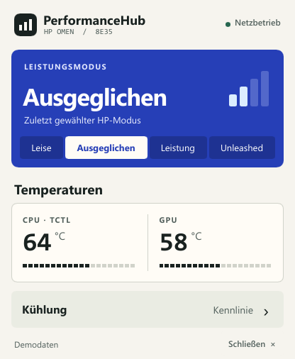

# Relay · Tray-Flyout

Relay ist für den kurzen Blick während eines Spiels gedacht. Der zuletzt gewählte HP-Modus nimmt die obere Hälfte ein. Direkt darunter stehen die CPU-Regeltemperatur und die GPU-Temperatur. Ein Klick auf einen der vier Modi wechselt die lokale Auswahl. **Kühlung** öffnet im selben Fenster den Lüftermodus und die beiden Drehzahlen.



## Vorschau und Bedienung

[`main.slint`](main.slint) im Slint-Preview öffnen oder in diesem Ordner `slint-viewer main.slint` ausführen. Die Datei ist eigenständig. Sie zeigt feste Demowerte für einen HP OMEN mit Board 8E35 am Netz. Ein Wechsel des Modus ändert ausschließlich die Auswahl im Template. Die dargestellten Temperaturen und Drehzahlen sind unabhängige Messbeispiele.

- **Tab / Umschalt+Tab** bewegt den sichtbaren Fokus. **Eingabe** oder **Leertaste** löst die fokussierte Aktion aus.
- **Esc** führt aus der Kühlung zurück. In der Übersicht schließt Esc das Flyout. **Schließen** ist in beiden Ansichten erreichbar.
- Die große Modusanzeige nennt die letzte Auswahl, weil der HP-Thermalmodus kein zuverlässiges GET bietet. Hier wären „bestätigt“ oder „ausgelesen“ irreführend. [HP-Modell](../../crates/core/src/hp_mode.rs)

## Aufbau

Beide Ansichten belegen **416 × 506 logische Pixel**. Der Wechsel hält die untere Navigation am selben Ort. Der Modusname ist bei einem kurzen Blick das erste Leseziel, das Temperaturpaar das zweite. [Screenshot der Kühlungsansicht](kuehlung.png)

```text
Übersicht                     Kühlung
Gerät · Netzbetrieb           Gerät · Netzbetrieb
Modus in groß                 Lüftermodus in groß
Vier HP-Modi                  BIOS / Kennlinie / Maximum
CPU Tctl | GPU                CPU-Lüfter    U/min
Temperatur | Temperatur       GPU-Lüfter    U/min
Kühlung · Kennlinie  ›        Zur Übersicht        ‹
Demodaten · Schließen         Demodaten · Schließen
```

| Element | Gestaltung und Bedeutung |
| --- | --- |
| Flächen | Warmes Papier `#F6F4EE`, Messfeld `#FFFCF6`, Trennlinie `#D1D3CA`, Text `#192220`. |
| Modus | Kobalt `#263FB7` bündelt Namen und Auswahl. Die Zahl heller Balken identifiziert die gewählte HP-Stufe und stellt keine Lastmessung dar. |
| Status | Grün `#276650` markiert Netzbetrieb. Die Thermometer nutzen Tinte, ab 80 °C Ocker `#925011`, ab 90 °C Rot `#A22C32`. Das sind illustrative Anzeigeschwellen auf einer Skala von 0–100 °C. Eine Integration braucht geräte- und sensorspezifische Grenzen. Hohe Last allein ist kein Temperaturfehler. |
| Typografie und Dichte | Segoe UI für Bedienung, Consolas als Windows-Monospace mit gleich breiten Ziffern für Messwerte. 37 px für Temperatur, 34 px für Modus, 13–16 px für die Bedienung. 16 px Außenrand, 32 px Höhe je Modus, 52 px für den Detailwechsel. |

## Machbarkeit unter Windows 11

**Vorhandene Anknüpfungspunkte.** Die Modi entsprechen `HpMode`. Für die Lüfterauswahl stellt `FanMode` BIOS, Kurve und Maximum bereit. BIOS pausiert nach der Freigabe die eigene Regelung. Die separate CPU- und GPU-Drehzahl ist im Modell optional. Ein angeschlossenes UI muss fehlende oder alte Messungen kennzeichnen und die vorhandenen gerätespezifischen Voraussetzungen für Schreibaktionen prüfen. [Lüftermodi](../../crates/core/src/quick_switch.rs) · [Drehzahlmodell](../../crates/core/src/cooling.rs) · [CPU-Sensoren](../../docs/CPU_SENSORS.md)

**Slint-Anteil.** Flächen, Balken, Fokus, lokale Auswahl und Ansichtswechsel sind deklarativ. Ohne Timer bleibt das Flyout zwischen Eingaben und neuen Messwerten ruhig. Die Projektkonfiguration bietet winit mit Software und FemtoVG. Für diese wenigen Rechtecke gibt es keinen Grund, Skia als weitere Abhängigkeit einzuführen. Ob Software oder FemtoVG weniger Energie verbraucht, lässt sich erst am Zielgerät messen. [Build-Konfiguration](../../crates/app/Cargo.toml)

**Erweiterung für die Shell.** Das Repository besitzt bereits ein Win32-Traysymbol. Das Ankern dieses zusätzlichen Flyouts an dessen Bildschirmkoordinaten, das Einpassen in die Arbeitsfläche des jeweiligen Monitors sowie das Schließen bei Fokusverlust gehören in den Host. Beim Verstecken sollen Anzeigeabfragen ruhen und die unabhängige Lüfterregelung weiterlaufen. Das feste logische Raster skaliert mit dem DPI-Faktor. 125–200 %, Taskleistenränder und Monitorwechsel sind auf Windows zu prüfen. [Tray-Implementierung](../../crates/app/src/tray.rs)

**Review.** Übersicht und Kühlungsdetail wurden mit `check_slint` (Slint 1.19.1, Wasm-Software-Renderer) kompiliert und als PNG auf Textbeschnitt, Auswahlzustände und Ausrichtung geprüft. Die Windows-App bindet Slint 1.18.1. Die Vorschau prüft weder den Shell-Anker noch native Readbacks.
