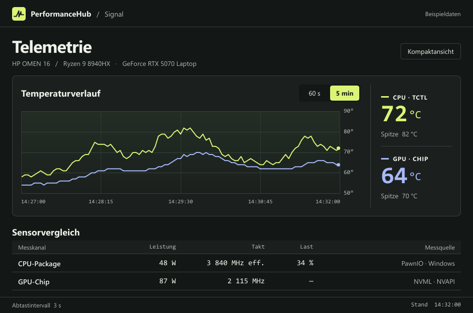

# Signal · Telemetrie-Cockpit

Signal beantwortet zwei Fragen während einer Lastspitze. Welcher Chip wird wärmer, und ist seine Temperatur gerade wieder gefallen? Der Blick trifft zuerst die beiden Zahlen rechts vom Verlauf. Im Fünf-Minuten-Beispiel steht die CPU bei **72 °C nach einer Spitze von 82 °C**, die GPU bei **64 °C nach 70 °C**. Rechts beziehen sich Zahl, Einheit und Spitze immer auf denselben beschrifteten Kanal.



## Bedienung

| Ansicht | Aufbau von oben nach unten |
| --- | --- |
| **Cockpit · 940 × 622 logische Pixel** | Gerät und Kompaktumschalter → gemeinsame Temperaturachse und zwei aktuelle Werte → Sensorvergleich mit tatsächlicher Leistungsaufnahme, Takt, Last und Quelle → Messzeit |
| **Kompakt · 420 × 264 logische Pixel** | Gerätelogo und Rückweg zum Verlauf → CPU- und GPU-Paar mit Spitzen → gewähltes Zeitfenster und Zeitpunkt |

**60 s** vergrößert die letzten 21 der 101 Messpunkte. **5 min** zeigt die gesamte Sequenz. Beide Ansichten enden bei 14:32:00 Uhr. **Kompaktansicht** blendet Kurven und Tabelle aus. **Verlauf öffnen** führt mit demselben Zeitfenster zurück. Tab erreicht die Aktionen, Eingabe oder Leertaste aktiviert sie. [Kompaktansicht](kompakt.png)

Vom Repository-Stamm aus lassen sich der Einstieg und ein fehlender CPU-Hardwaresensor so vergleichen:

```powershell
slint-viewer ui-templates/signal/main.slint
'{"short-range":true,"cpu-available":false}' | slint-viewer --load-data - ui-templates/signal/main.slint
```

## Farben und Messwerte

- **Flächen.** Nachtgrün `#131716`, angehobenes Messfeld `#1B201E`, Raster `#39413D`, Text `#EFF2E9`. Limette `#DBF476` kennzeichnet CPU und aktive Zeitwahl. Blaugrau `#A7BAFA` identifiziert die GPU. Beide Linien haben eine gemeinsame Skala von 50–90 °C für diesen Datensatz.
- **Zustände.** Für fehlende Messungen stehen ein Gedankenstrich und „Sensor fehlt“. 34 % Windows-CPU-Last bleiben bei ausgefallenem Hardwareleser darstellbar. Für eine spätere Live-Ansicht sind Bernstein `#EFBC69` und Koralle `#FF9483` zusammen mit „Warm“ und „Temperaturgrenze“ vorgesehen. Die Grenzwerte müssen aus der Sensor- und Gerätepolitik kommen. Prozentuale Last allein löst keine Temperaturwarnung aus.
- **Dichte.** Segoe UI für Bezeichnungen, Consolas für gleich breite Ziffern, 48 px für Leitwerte, 14–15 px für die Tabelle. Die kompakte Darstellung bewahrt dieselbe Temperaturtypografie. Systemschriften benötigen keine Fontdatei im Paket.

## Daten und Machbarkeit

`CpuSample` liefert optional Tctl, Package-Leistung, effektive Takte über `hardware.effective_clocks` und Windows-Last. Die Beispielzeile zeigt den höchsten intervalleffektiven CPU-Takt. `GpuSample` enthält Chiptemperatur, Grafiktakt und Watt. Für GPU-Last fehlt ein Feld, daher steht in dieser Spalte ein Strich. Watt sind hier Leistungsaufnahme. Ein PPT-/TGP-Limit wäre ein eigener Sollwert. [Messmodelle](../../crates/core/src/lib.rs) · [CPU-Sensoren](../../docs/CPU_SENSORS.md) · [NVIDIA-Leser](../../crates/platform/src/windows/nvidia.rs)

**Erweiterung für den Livebetrieb.** Die Templates halten feste Beispieldaten im Speicher. Die Produktansicht bräuchte einen begrenzten Verlauf mit Messzeitpunkten, Lücken bei veralteten Proben und einer Achse, die den sichtbaren Wertebereich umfasst. Ein Eintrag pro eintreffender Probe genügt. Der vorhandene Sichtbarkeitszustand kann die Aufzeichnung beim Verstecken anhalten. Beim Öffnen beginnt ein neuer sichtbarer Abschnitt. So entfällt ein eigener Diagramm-Timer.

**Windows.** Zwei Slint-`Path`-Elemente zeichnen die Kurven. Ein Wechsel des Zeitfensters verschiebt den Ausschnitt. Die Titelleiste gehört dem Fensterhost. Für die festen Fenstermaße muss der Host beim Öffnen die logische Arbeitsfläche des jeweiligen Monitors berücksichtigen und auf kleinen Displays mit der Kompaktansicht starten. Als erste Vergleichsbasis dient der vorhandene Winit-Software-Renderer. Der Aufwand eines anderen Renderers lohnt sich erst, wenn ein Profiling einen Engpass beim Diagrammzeichnen zeigt. [Slint-Path 1.18.1](https://releases.slint.dev/1.18.1/docs/slint/reference/elements/path/) · [Renderervergleich](../README.md#windows-11-und-laufzeit)
