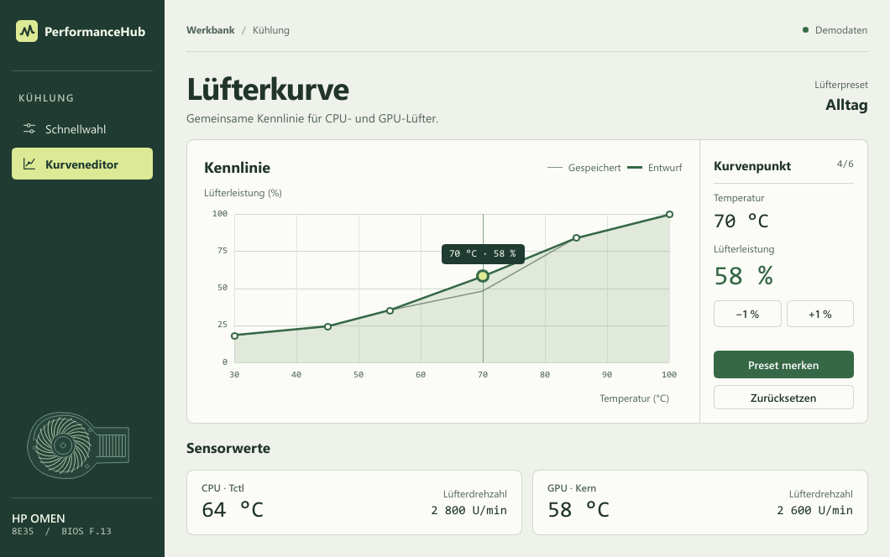

# Werkbank

Die Werkbank ist für den Moment gedacht, in dem jemand eine Lüfterkurve abstimmt. Der gewählte Punkt zeigt unmittelbar, was die Bearbeitung verändert. Im Beispiel liegt der neue Sollwert bei **58 % Lüfterleistung für 70 °C**. Die dünne Vergleichslinie zeigt die gespeicherten 48 %. Die Temperaturen und Drehzahlen unter dem Editor sind separate Beispielmessungen.



## Bedienung und Fenster

```text
Detail · 1060 × 664 logische Pixel       Schnellwahl · 620 × 580
┌──────────┬────────────────────────┐     ┌──────────────────────┐
│ Kühlung  │ Lüfterkurve      Preset│     │ Kühlmodus      Preset│
│ Schnell- ├───────────────┬────────┤     ├──────────────────────┤
│ wahl     │ Kennlinie     │ Punkt  │     │ Automatik            │
│ Kurven-  │               │ °C, %  │     │ Kennlinie            │
│ editor   │  Raster       │ − / +  │     │ Maximum              │
│          │               │ Merken │     │ Kurve bearbeiten     │
│          ├───────────────┴────────┤     ├──────────┬───────────┤
│ Gerät    │ CPU        │ GPU       │     │ CPU      │ GPU       │
└──────────┴────────────┴───────────┘     └──────────┴───────────┘
```

Einen Punkt anklicken oder mit Tab und Eingabe auswählen. **−1 %** und **+1 %** verschieben seinen Sollwert um einen Prozentpunkt. Die beiden benachbarten Werte begrenzen den Schritt. **Preset merken** übernimmt den Entwurf für die laufende Vorschau. **Zurücksetzen** lädt diese lokale Fassung. Beim Wechsel über **Schnellwahl** und **Kurve bearbeiten** bleibt der Entwurf erhalten. Alle Werte und Anforderungen sind simuliert. [Screenshot der Schnellwahl](schnellwahl.png)

Die eigenständige Datei lässt sich im Slint-MCP über `check_slint` oder im Viewer öffnen. Für den Direkteinstieg in die Schnellwahl unter PowerShell das JSON über die Standardeingabe übergeben.

```powershell
slint-viewer ui-templates/werkbank/main.slint
'{"quick":true}' | slint-viewer --load-data - ui-templates/werkbank/main.slint
```

## Visuelles System

| Element | Gestaltung |
| --- | --- |
| Arbeitsfläche und Papier | Salbeigrau `#EFF1EB`, angehobene Felder `#FBFCF8`, Trennlinien `#D0D8CC` |
| Navigation und Auswahl | Tannengrün `#203B31`, selektierter Modus `#DCEA95`, bearbeitete Kennlinie `#366846` |
| Messwerte | Regulär `#20342B`, erhöht `#81560D`, kritisch `#9C3F38` mit zusätzlichem Statuswort. Künftige Temperatur- oder Lastwarnungen benötigen eine gerätespezifische Einstufung. |
| Schrift und Dichte | Segoe UI für Beschriftungen, Consolas mit gleich breiten Ziffern für Soll- und Messwerte. Sechs auswählbare Punkte, 14-px-Grundschrift, 12-px-Nebenwerte, 26 px Außenabstand im Detailfenster. |

## Anschluss an PerformanceHub

Das vorhandene `FanPreset` bindet eine gemeinsame Kurve an Board und BIOS. Die sechs Temperaturanker und das benannte Preset „Alltag“ sind Beispieldaten. Der Validator akzeptiert 2–56 Punkte, streng aufsteigende Temperaturen von 0–110 °C und nicht fallende Sollwerte von 0–100 %. In der Schnellwahl entsprechen die Modi den vorhandenen Anforderungen `bios`, `curve` und `max`. Eine erfolgreiche Anforderung bestätigt noch keine physische Übernahme. [Presets](../../crates/core/src/fan_profile.rs) · [Kühlungsadapter](../../docs/FAN_CONTROL.md) · [Werteprüfung](../../crates/core/src/profiles.rs) · [Punktlimit](../../crates/core/src/curve_editor.rs)

Slint zeichnet die Vergleichslinien als skalierbare `Path`-Elemente. Raster, Auswahl und Trefferflächen nutzen dieselbe Koordinatenabbildung. Das Template benötigt weder Timer noch laufende Animation. Bei einer Integration kann der bestehende Rust-Editor Drag-Gesten, Werteprüfung und Undo übernehmen. Zeigerkoordinaten müssen dabei im logischen Koordinatensystem der Zeichenfläche bleiben. Das verdeckte Fenster benötigt keine Neuzeichnung für neue Sensorwerte.

Das Konzept verwendet die normale Windows-Titelleiste. Ein direkt am Tray-Symbol positioniertes Fenster wäre eine Erweiterung des Hosts und benötigt die Arbeitsfläche und Skalierung des jeweiligen Monitors. Für die Integration sind Winit mit Software-Renderer und FemtoVG im Projekt aktiviert. Skia würde ein zusätzliches Build-Feature erfordern. Beide Layouts wurden mit dem Slint-MCP 1.19.1 visuell geprüft. Die gespeicherten Screenshots stammen vom Viewer in Projektversion 1.18.1. Schärfe bei Monitorwechsel, Narrator und die Eingabelatenz beim Ziehen bleiben auf Windows am Gerät zu prüfen. [Renderer im Projekt](../../crates/app/Cargo.toml) · [Vorhandene Drag-Behandlung](../../crates/app/src/slint_ui/curve.rs)
